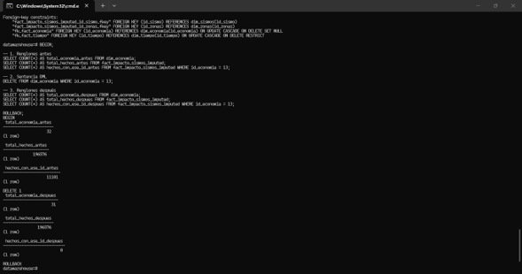

# Práctica 5 — Ejercicio 2.3: Pruebas de integridad referencial

**Proyecto:** Sistema de Visualizacion de datos Sismicos en Mexico (`datawarehouse`)

---

## 1. Pruebas por cada acción referencial usada

Se probaron con datos reales las tres acciones referenciales configuradas en el esquema del Data Warehouse (`ON DELETE RESTRICT`, `ON DELETE SET NULL` y `ON UPDATE CASCADE`).

### 1.1. Prueba con `ON DELETE RESTRICT` (`dim_sismos` → `fact_impacto_sismos_imputed`)

Se intentó eliminar el registro padre con `id_sismo = 0`, el cual cuenta con hechos asociados en `fact_impacto_sismos_imputed`.

```sql
-- 1. Renglones antes
SELECT COUNT(*) AS total_sismos_antes FROM dim_sismos;
SELECT COUNT(*) AS total_hechos_antes FROM fact_impacto_sismos_imputed;

-- 2. Sentencia DML
DELETE FROM dim_sismos WHERE id_sismo = 0;

-- 3. Renglones después
SELECT COUNT(*) AS total_sismos_despues FROM dim_sismos;
SELECT COUNT(*) AS total_hechos_despues FROM fact_impacto_sismos_imputed;
```

**Mensaje del gestor:**
```text
ERROR: update or delete on table "dim_sismos" violates foreign key constraint "fact_impacto_sismos_imputed_id_sismo_fkey" on table "fact_impacto_sismos_imputed"
DETAIL: Key (id_sismo)=(0) is still referenced from table "fact_impacto_sismos_imputed".
```

| Tabla | Renglones antes | Renglones después | Comportamiento observado |
| :--- | :---: | :---: | :--- |
| `dim_sismos` (padre) | 319,592 | 319,592 | Borrado bloqueado; se conserva el registro. |
| `fact_impacto_sismos_imputed` (hija) | 196,576 | 196,576 | Sin cambios; se preserva la integridad referencial. |


---

### 1.2. Prueba con `ON DELETE SET NULL` (`dim_economia` → `fact_impacto_sismos_imputed`)

Dentro de una transacción controlada (`BEGIN` / `ROLLBACK`), se eliminó el registro padre con `id_economia = 13`, el cual estaba referenciado por `11,101` registros en la tabla de hechos.

```sql
BEGIN;

-- 1. Renglones antes
SELECT COUNT(*) AS total_economia_antes FROM dim_economia;
SELECT COUNT(*) AS total_hechos_antes FROM fact_impacto_sismos_imputed;
SELECT COUNT(*) AS hechos_con_ese_id_antes FROM fact_impacto_sismos_imputed WHERE id_economia = 13;

-- 2. Sentencia DML
DELETE FROM dim_economia WHERE id_economia = 13;

-- 3. Renglones después
SELECT COUNT(*) AS total_economia_despues FROM dim_economia;
SELECT COUNT(*) AS total_hechos_despues FROM fact_impacto_sismos_imputed;
SELECT COUNT(*) AS hechos_con_ese_id_despues FROM fact_impacto_sismos_imputed WHERE id_economia = 13;

ROLLBACK;
```

| Tabla / Condición | Renglones antes | Renglones después | Comportamiento observado |
| :--- | :---: | :---: | :--- |
| `dim_economia` (padre) | 32 | 31 | Se elimina el registro económico (`DELETE 1`). |
| `fact_impacto_sismos_imputed` (total) | 196,576 | 196,576 | Los hechos sísmicos sobreviven sin eliminarse. |
| `fact_impacto_sismos_imputed` (`id_economia = 13`) | 11,101 | 0 | Las referencias pasaron automáticamente a `NULL`. |



---

### 1.3. Prueba con `ON UPDATE CASCADE` (`dim_tiempo` → `fact_impacto_sismos_imputed`)

Dentro de una transacción controlada, se actualizó la llave primaria `id_tiempo = 0` a `99999999` en la tabla padre `dim_tiempo`.

```sql
BEGIN;

-- 1. Renglones antes
SELECT COUNT(*) AS total_tiempo_antes FROM dim_tiempo;
SELECT COUNT(*) AS hechos_con_id_viejo_antes FROM fact_impacto_sismos_imputed WHERE id_tiempo = 0;

-- 2. Sentencia DML
UPDATE dim_tiempo SET id_tiempo = 99999999 WHERE id_tiempo = 0;

-- 3. Renglones después
SELECT COUNT(*) AS total_tiempo_despues FROM dim_tiempo;
SELECT COUNT(*) AS hechos_con_id_viejo_despues FROM fact_impacto_sismos_imputed WHERE id_tiempo = 0;
SELECT COUNT(*) AS hechos_con_id_nuevo_despues FROM fact_impacto_sismos_imputed WHERE id_tiempo = 99999999;

ROLLBACK;
```

| Tabla / Condición | Renglones antes | Renglones después | Comportamiento observado |
| :--- | :---: | :---: | :--- |
| `dim_tiempo` (padre) | 319,592 | 319,592 | Se actualiza el identificador (`UPDATE 1`). |
| `fact_impacto_sismos_imputed` (`id_tiempo = 0`) | 1 | 0 | Deja de existir la referencia al ID anterior. |
| `fact_impacto_sismos_imputed` (`id_tiempo = 99999999`) | 0 | 1 | El registro hijo hereda automáticamente el nuevo ID. |


---

## 2. `INSERT` con clave foránea inexistente

Se verificó que `id_sismo = 999999999` no existiera en `dim_sismos` y posteriormente se intentó insertar un registro en `fact_impacto_sismos_imputed` apuntando a dicha clave.

```sql
-- 1. Confirmamos que el id_sismo = 999999999 NO existe en la tabla padre
SELECT COUNT(*) AS existe_sismo FROM dim_sismos WHERE id_sismo = 999999999;

-- 2. Intentamos insertar un hecho apuntando a ese id_sismo inexistente
INSERT INTO fact_impacto_sismos_imputed (
    id_sismo, id_zonas, id_economia, id_tiempo,
    poblacion_afectada, impacto_economico, determinante_de_riesgo,
    riesgo_proporcional, indice_zscore
)
VALUES (
    999999999, 1, 1, 0,
    5000, 120000.50, 0.45, 0.30, 1.15
);
```

**Mensaje con que el gestor lo rechaza:**
```text
ERROR: insert or update on table "fact_impacto_sismos_imputed" violates foreign key constraint "fact_impacto_sismos_imputed_id_sismo_fkey"
DETAIL: Key (id_sismo)=(999999999) is not present in table "dim_sismos".
```


---

## 3. Orden de carga de tablas

### Qué ocurre si se cargan las tablas hijas antes que las padres

Al intentar insertar datos en la tabla hija (`fact_impacto_sismos_imputed`) con llaves (`id_sismo = 888888`) que aún no han sido insertadas en las tablas dimensiones (`dim_sismos`), PostgreSQL rechaza la carga por violación de integridad referencial:

```sql
BEGIN;

INSERT INTO fact_impacto_sismos_imputed (
    id_sismo, id_zonas, id_economia, id_tiempo,
    poblacion_afectada, impacto_economico, determinante_de_riesgo,
    riesgo_proporcional, indice_zscore
)
VALUES (
    888888, 1, 1, 0,
    1000, 50000.0, 0.2, 0.1, 0.5
);

ROLLBACK;
```

**Mensaje de error obtenido:**
```text
ERROR: insert or update on table "fact_impacto_sismos_imputed" violates foreign key constraint "fact_impacto_sismos_imputed_id_sismo_fkey"
DETAIL: Key (id_sismo)=(888888) is not present in table "dim_sismos".
```

### Cómo se resuelve

Se estructura el script DDL y DML siguiendo estrictamente la jerarquía de dependencias del modelo estrella:

1. **Nivel 1 (Tablas Padre / Dimensiones independientes):** Se crean y pueblan primero `dim_sismos`, `dim_zonas`, `dim_economia` y `dim_tiempo`.
2. **Nivel 2 (Tabla Hija / Tabla de Hechos):** Una vez garantizada la existencia de todas las llaves primarias en las dimensiones, se crea y puebla `fact_impacto_sismos_imputed`.

```sql
-- Orden correcto de carga:
-- 1. Cargar dimensiones (padres)
\copy dim_sismos FROM 'dim_sismos.csv' CSV HEADER;
\copy dim_zonas FROM 'dim_zonas.csv' CSV HEADER;
\copy dim_economia FROM 'dim_economia.csv' CSV HEADER;
\copy dim_tiempo FROM 'dim_tiempo.csv' CSV HEADER;

-- 2. Cargar tabla de hechos (hija)
\copy fact_impacto_sismos_imputed FROM 'fact_impacto_sismos_imputed.csv' CSV HEADER;
```


---

## 4. Comprobaciones de integridad (consultas vacías en ambas bases)

Se ejecutaron las consultas de auditoría sobre `datawarehouse` y `datawarehouse_copia` para verificar la ausencia de llaves foráneas huérfanas, duplicados en llaves únicas/primarias y valores nulos en columnas obligatorias.

```sql
-- ==========================================
-- 1. CLAVES FORÁNEAS HUÉRFANAS (0 renglones)
-- ==========================================
SELECT f.id_sismo
FROM fact_impacto_sismos_imputed f
LEFT JOIN dim_sismos s ON f.id_sismo = s.id_sismo
WHERE f.id_sismo IS NOT NULL AND s.id_sismo IS NULL;

SELECT f.id_zonas
FROM fact_impacto_sismos_imputed f
LEFT JOIN dim_zonas z ON f.id_zonas = z.id_zonas
WHERE f.id_zonas IS NOT NULL AND z.id_zonas IS NULL;

SELECT f.id_economia
FROM fact_impacto_sismos_imputed f
LEFT JOIN dim_economia e ON f.id_economia = e.id_economia
WHERE f.id_economia IS NOT NULL AND e.id_economia IS NULL;

SELECT f.id_tiempo
FROM fact_impacto_sismos_imputed f
LEFT JOIN dim_tiempo t ON f.id_tiempo = t.id_tiempo
WHERE f.id_tiempo IS NOT NULL AND t.id_tiempo IS NULL;

-- ==========================================
-- 2. DUPLICADOS EN COLUMNAS ÚNICAS / PK (0 renglones)
-- ==========================================
SELECT id_sismo, COUNT(*) FROM dim_sismos GROUP BY id_sismo HAVING COUNT(*) > 1;
SELECT id_zonas, COUNT(*) FROM dim_zonas GROUP BY id_zonas HAVING COUNT(*) > 1;
SELECT id_economia, COUNT(*) FROM dim_economia GROUP BY id_economia HAVING COUNT(*) > 1;
SELECT id_tiempo, COUNT(*) FROM dim_tiempo GROUP BY id_tiempo HAVING COUNT(*) > 1;

-- ==========================================
-- 3. NULOS EN COLUMNAS NOT NULL (0 renglones)
-- ==========================================
SELECT COUNT(*) AS nulos_sismos FROM dim_sismos WHERE id_sismo IS NULL;
SELECT COUNT(*) AS nulos_zonas FROM dim_zonas WHERE id_zonas IS NULL;
SELECT COUNT(*) AS nulos_economia FROM dim_economia WHERE id_economia IS NULL;
SELECT COUNT(*) AS nulos_tiempo FROM dim_tiempo WHERE id_tiempo IS NULL;
```

### Resultados obtenidos

| Comprobación | Base `datawarehouse` | Base `datawarehouse_copia` | Estado |
| :--- | :---: | :---: | :---: |
| Claves foráneas huérfanas | `0 rows` | `0 rows` | Aprobado |
| Duplicados en columnas únicas | `0 rows` | `0 rows` | Aprobado |
| Nulos en columnas `NOT NULL` | `0` | `0` | Aprobado |


